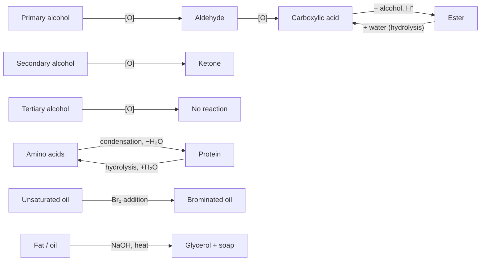

# Higher Chemistry — Organic Reactions

## A revision plan for Nature's chemistry

> **Aligned to:** Higher Chemistry (SCQF Level 6), Nature's chemistry, current Qualifications Scotland / SQA course specification valid from session 2026–27.  
> **Best used with:** the interactive HTML site in this folder — `index.html`, `reactions.html`, `flashcards.html`, `quiz.html` and `resources.html`.
>
> **Viewing note:** Mermaid diagrams render on GitHub, in VS Code with Mermaid support, and in many markdown viewers. If your viewer does not support Mermaid, open `reactions.html` for the same visual reaction map.
>
> This is an independent revision resource. Your teacher and the current course specification are the final authority on what you must know.

---

## Contents

1. [How to use this plan](#1-how-to-use-this-plan)
2. [Curriculum map](#2-curriculum-map)
3. [The reaction map](#3-the-reaction-map)
4. [Core reaction cards](#4-core-reaction-cards)
5. [The revision plan](#5-the-revision-plan)
6. [Flashcards](#6-flashcards)
7. [Quiz bank](#7-quiz-bank)
8. [Exam-style questions and model answers](#8-exam-style-questions-and-model-answers)
9. [Common misconceptions](#9-common-misconceptions)
10. [Practical skills](#10-practical-skills)
11. [Further resources](#11-further-resources)
12. [Progress tracker](#12-progress-tracker)

---

## 1. How to use this plan

### The big idea

Organic chemistry is not a list of unrelated reactions. It is a **map of functional-group changes**. If you know:

- the functional group,
- the reagent and conditions,
- the product,
- and the observation,

then you can answer most Higher questions even when the molecule is unfamiliar.

### The 20-minute loop

Use this loop for every session. It is deliberately active.

| Step | Time | What you do |
|---|---:|---|
| **Retrieve** | 4 min | Close the notes. Write everything you remember about the reaction or topic. |
| **Learn** | 6 min | Read one reaction card or revision-guide section. Correct your blank-page attempt. |
| **Draw** | 4 min | Draw the structures, functional groups and equation from memory. |
| **Apply** | 4 min | Answer one exam-style question. |
| **Check** | 2 min | Mark it. Write the missed idea as a one-line rule in your error log. |

### The five rules

1. **Retrieval beats rereading.** If you can't write it without notes, you don't know it yet.
2. **Draw structures by hand.** Full or shortened structural formulae are exam skills.
3. **Say the observation.** “Orange to green”, “brick-red precipitate”, “silver mirror”, “decolourised”.
4. **Use the command word.** Describe ≠ explain.
5. **Revisit.** Review new material after 1 day, 3 days, 7 days and 14 days.

### Materials

- Higher Chemistry data booklet
- A4 jotter or flashcard app
- Past paper questions and marking instructions
- A one-page error log
- The reaction cards in this plan or the HTML reaction lab

---

## 2. Curriculum map

The current Higher Chemistry Nature's chemistry content includes the areas below. The reactions in **bold** are the core focus of this plan.

| Area | You should be able to | Reaction link |
|---|---|---|
| **Systematic carbon chemistry** | Identify saturated/unsaturated compounds; draw and name structures; explain isomerism; use bromine solution to test for unsaturation. | **Addition of bromine across C=C** |
| **Alcohols** | Classify primary, secondary and tertiary alcohols; identify diols and triols; explain hydrogen bonding and physical properties. | **Oxidation**; esterification |
| **Carboxylic acids** | Name acids; describe weak-acid behaviour; react with metal oxides, hydroxides and carbonates. | **Acid–base reactions**; esterification |
| **Esters, fats and oils** | Name esters; describe condensation and hydrolysis; explain melting points and unsaturation. | **Esterification**; **hydrolysis**; **bromine addition** |
| **Soaps, detergents and emulsions** | Describe alkaline hydrolysis; explain soap ions, micelles, hard water, detergents and emulsifiers. | **Saponification** |
| **Proteins** | Describe amino acids, peptide links, condensation, hydrolysis, essential amino acids and denaturation. | **Condensation**; **hydrolysis**; denaturation |
| **Oxidation of food** | Define oxidation/reduction using O:H ratio; oxidise primary/secondary alcohols; test aldehydes/ketones; explain antioxidants and rancidity. | **Oxidation**; **aldehyde tests** |
| **Fragrances** | Describe essential oils and terpenes; identify isoprene units. | **Oxidation in plants** (context) |
| **Skin care** | Describe UV damage, free radicals, chain reactions and scavengers. | **Free radical chain reactions** |

### Core vs extension

| Status | Content |
|---|---|
| **Higher core** | Oxidation of alcohols; aldehyde/ketone tests; carboxylic acid + base; esterification; ester hydrolysis; fats/oils + bromine; soap formation and micelles; protein condensation/hydrolysis/denaturation; antioxidants; terpenes; free radical chains. |
| **Extension / prior learning** | Addition of H₂, Br₂, HX or H₂O to alkenes; dehydration of alcohols; reduction of aldehydes/ketones; Markovnikov's rule; detailed mechanisms. These are useful for the bigger picture and for Advanced Higher, but check your own course notes. |

> **Important:** The current Higher specification explicitly includes addition reactions and the bromine test for unsaturation. Some older or extension material (for example, dehydration of alcohols or reduction of carboxylic acids) may appear in class or in past papers from earlier course versions. If in doubt, ask your teacher which statements apply to your year.

---

## 3. The reaction map



### The one-page summary

| Reaction | Functional group change | Reagent / condition | Tell-tale sign or product |
|---|---|---|---|
| Oxidation of a primary alcohol | –OH → –CHO → –COOH | Acidified dichromate(VI), heat; excess oxidant for acid | Orange → green; aldehyde then acid |
| Oxidation of a secondary alcohol | –OH → C=O | Acidified dichromate(VI), heat | Orange → green; ketone |
| Oxidation of a tertiary alcohol | no reaction | Acidified dichromate(VI) | Orange stays orange |
| Aldehyde test | –CHO → –COOH | Fehling's, Tollens' or acidified dichromate(VI) | Brick-red precipitate; silver mirror; orange → green |
| Carboxylic acid + base | –COOH → –COO⁻ salt | Metal oxide/hydroxide/carbonate | Salt + water (+ CO₂ with carbonate) |
| Esterification | –COOH + –OH → –COO– | Conc. H₂SO₄, warm | Ester + water; fruity smell |
| Ester hydrolysis | –COO– → –COOH + –OH | Water/acid or aqueous alkali | Acid + alcohol, or salt + alcohol |
| Bromine test | C=C → C–C | Bromine solution, shake | Orange-brown → colourless |
| Soap formation | Triglyceride → glycerol + soap | NaOH, heat | Glycerol + 3 soap molecules |
| Protein condensation | –NH₂ + –COOH → –CONH– | Condensation | Peptide link + water |
| Protein hydrolysis | –CONH– → –NH₂ + –COOH | Water/enzymes | Amino acids |
| Free radical chain | bond → radicals | UV/initiator; propagation; termination | Radical equations; stable product at termination |

---

## 4. Core reaction cards

### 4.1 Oxidation of alcohols

**What happens:** The –OH group is oxidised. The product depends on the class of alcohol.

```text
Primary:    CH₃CH₂OH + [O] → CH₃CHO + H₂O
            CH₃CHO + [O] → CH₃COOH
Overall:    CH₃CH₂OH + 2[O] → CH₃COOH + H₂O

Secondary:  CH₃CH(OH)CH₃ + [O] → CH₃COCH₃ + H₂O

Tertiary:   no reaction with acidified dichromate(VI) or hot CuO
```

**Reagents and conditions**

- Acidified potassium dichromate(VI), K₂Cr₂O₇/H₂SO₄, heated.
- Hot copper(II) oxide, CuO, heated.
- For an aldehyde: use excess alcohol and distil the aldehyde off as it forms.
- For a carboxylic acid: use excess oxidising agent and heat under reflux.

**Observations**

- Acidified dichromate(VI): **orange → green**.
- Hot copper(II) oxide: **black → brown solid** (copper(I) oxide).

**Exam tip:** Check the carbon carrying the –OH group. A tertiary alcohol has no hydrogen on that carbon, so it cannot be oxidised by these reagents.

**Mini-check:** Why does propan-2-ol give propanone rather than propanoic acid?  
<details><summary>Answer</summary>Propan-2-ol is a secondary alcohol. The carbon carrying the –OH group is bonded to only one hydrogen and two carbon groups, so oxidation stops at the ketone. The ketone is not further oxidised under these conditions.</details>

---

### 4.2 Testing for aldehydes and ketones

Aldehydes can be oxidised further; ketones cannot (with these reagents). This difference is the basis of three tests.

| Test | Aldehyde | Ketone |
|---|---|---|
| **Fehling's solution** | Blue → **brick-red precipitate** | Stays blue; no precipitate |
| **Tollens' reagent** | Clear/colourless → **silver mirror** | No silver mirror |
| **Acidified dichromate(VI)** | Orange → **green** | Orange stays orange |

**Equation for the oxidation step:**

```text
RCHO + [O] → RCOOH
```

**Exam tip:** “Brick-red precipitate” and “silver mirror” are observations. If asked to explain, say the aldehyde is oxidised to a carboxylic acid; the ketone cannot be oxidised in the same way.

**Mini-check:** A compound gives a silver mirror with Tollens' reagent. Is it an aldehyde or a ketone?  
<details><summary>Answer</summary>An aldehyde. Tollens' reagent is reduced to silver metal by an aldehyde, producing the silver mirror.</details>

---

### 4.3 Carboxylic acids reacting with bases

Carboxylic acids are weak acids, but they neutralise bases in the same pattern as other acids.

```text
acid + metal oxide     → salt + water
acid + metal hydroxide → salt + water
acid + metal carbonate → salt + water + carbon dioxide
```

**Examples**

```text
2CH₃COOH + CuO      → (CH₃COO)₂Cu + H₂O
CH₃COOH + NaOH      → CH₃COONa + H₂O
2CH₃COOH + Na₂CO₃   → 2CH₃COONa + H₂O + CO₂
```

**Salt naming:** Ethanoic acid → ethanoate; propanoic acid → propanoate; butanoic acid → butanoate.

**Exam tip:** Carbonate reactions produce carbon dioxide, which turns limewater milky. Long-chain fatty acids neutralised by sodium hydroxide form soaps.

**Mini-check:** Name the salt formed from propanoic acid and potassium hydroxide.  
<details><summary>Answer</summary>Potassium propanoate.</details>

---

### 4.4 Esterification

**What happens:** An alcohol and a carboxylic acid join by condensation, eliminating water and forming an ester link.

```text
alcohol + carboxylic acid ⇌ ester + water

CH₃CH₂OH + CH₃COOH ⇌ CH₃COOCH₂CH₃ + H₂O
ethanol    ethanoic acid   ethyl ethanoate   water
```

**Conditions:** Concentrated sulfuric acid catalyst; warm. The reaction is reversible.

**Naming:** The alcohol part comes first and ends in **–yl**; the acid part ends in **–oate**.

| Alcohol | Acid | Ester |
|---|---|---|
| Methanol | Ethanoic acid | Methyl ethanoate |
| Ethanol | Ethanoic acid | Ethyl ethanoate |
| Propan-1-ol | Ethanoic acid | Propyl ethanoate |
| Ethanol | Propanoic acid | Ethyl propanoate |

**Uses:** Flavourings, fragrances and solvents for non-polar compounds.

**Exam tip:** Esterification is **condensation**, not addition. A small molecule (water) is eliminated. Removing the ester or water shifts the equilibrium to the right and increases the yield.

**Mini-check:** Name the ester formed from butan-1-ol and methanoic acid.  
<details><summary>Answer</summary>Butyl methanoate.</details>

---

### 4.5 Hydrolysis of esters

Water breaks the ester link. The products depend on the conditions.

**Acid hydrolysis**

```text
ester + water ⇌ alcohol + carboxylic acid

CH₃COOCH₂CH₃ + H₂O ⇌ CH₃COOH + CH₃CH₂OH
```

**Alkaline hydrolysis**

```text
ester + sodium hydroxide → alcohol + sodium carboxylate

CH₃COOCH₂CH₃ + NaOH → CH₃COONa + CH₃CH₂OH
```

After alkaline hydrolysis, acidifying the mixture converts the carboxylate salt back to the carboxylic acid.

**Fats and oils:** Alkaline hydrolysis of a triglyceride is called **saponification**. It produces glycerol and three soap molecules.

**Exam tip:** Read the condition before naming products. “Hydrolysed with water” gives acid + alcohol; “hydrolysed with sodium hydroxide” gives salt + alcohol.

**Mini-check:** What are the products of alkaline hydrolysis of ethyl ethanoate?  
<details><summary>Answer</summary>Ethanol and sodium ethanoate.</details>

---

### 4.6 Fats, oils and the bromine test

**Structure:** A triglyceride is formed by condensation of glycerol (propane-1,2,3-triol) with three fatty acid molecules.

**Saturated vs unsaturated**

- Saturated fatty acid chains have only single C–C bonds.
- Unsaturated chains contain one or more C=C double bonds.
- More unsaturation → more kinks → poorer packing → weaker London dispersion forces → lower melting point.
- Therefore oils generally have lower melting points than fats.

**Bromine test**

```text
unsaturated oil + Br₂ → brominated oil
orange-brown bromine solution → colourless
```

Bromine adds across the C=C double bond. A saturated fat does not decolourise bromine solution quickly.

**Exam tip:** Say **decolourised**, not “clear”. Link the result to addition across C=C, not to a colour “disappearing” for no reason.

**Mini-check:** Why does an unsaturated oil decolourise more bromine solution than a saturated fat?  
<details><summary>Answer</summary>It has more C=C double bonds, so more bromine molecules can add across them.</details>

---

### 4.7 Soaps, detergents and emulsions

**Soap formation**

```text
triglyceride + 3NaOH → glycerol + 3 soap molecules
```

The soap molecules are sodium salts of fatty acids. The fatty acid molecules are neutralised by the alkali.

**Soap ion structure**

- **Hydrophobic tail:** long non-polar hydrocarbon chain; dissolves in oil/grease.
- **Hydrophilic head:** ionic carboxylate group; dissolves in water.

**Micelle formation:** Tails dissolve in grease; heads remain in water. Agitation forms ball-like micelles. The negatively charged heads repel each other, keeping grease suspended in water.

**Hard water:** Contains high levels of dissolved Ca²⁺ and Mg²⁺ ions. These form an insoluble precipitate (scum) with soap ions.

**Soapless detergents:** Have non-polar hydrophobic tails and ionic hydrophilic heads. They clean in the same way but do not form scum with hard water.

**Emulsifiers:** Have hydrophilic and hydrophobic parts. They prevent non-polar and polar liquids from separating into layers. Food emulsifiers can be made by reacting edible oils with glycerol.

**Exam tip:** A labelled micelle diagram is often the fastest full-mark answer. Label the hydrophilic head, hydrophobic tail, oil droplet and water.

**Mini-check:** Why does soap form scum in hard water?  
<details><summary>Answer</summary>Ca²⁺ and Mg²⁺ ions in hard water react with soap ions to form an insoluble precipitate called scum.</details>

---

### 4.8 Proteins: condensation, hydrolysis and denaturation

**Amino acids** contain an amino group (–NH₂) and a carboxyl group (–COOH). The R group is different for each amino acid.

**Condensation**

```text
amino acid + amino acid → dipeptide + water
```

The link formed is the **peptide link** (amide link), –CONH–. It forms between the amino group of one amino acid and the carboxyl group of another.

**Hydrolysis**

```text
protein + water → amino acids
```

Water breaks the peptide links. In the body, enzymes catalyse this during digestion.

**Denaturation**

- Heat or pH change breaks intermolecular forces between side chains.
- The protein changes shape.
- **Peptide bonds stay intact**, so amino acids are not produced.
- In food, denaturation changes texture (for example, egg white solidifying).

**Counting water molecules:** Joining *n* amino acids in one chain forms *n − 1* peptide links and releases *n − 1* water molecules.

**Exam tip:** Denaturation ≠ hydrolysis. Denaturation changes shape; hydrolysis breaks peptide bonds.

**Mini-check:** Why does heating an egg white change its texture but not produce amino acids?  
<details><summary>Answer</summary>Heating denatures the protein: it breaks intermolecular forces and changes the protein's shape. Peptide bonds remain intact, so hydrolysis into amino acids does not occur.</details>

---

### 4.9 Antioxidants and rancidity

**Oxidation of food:** Oxygen from the air oxidises edible oils, giving a rancid flavour.

**Antioxidants:**

- prevent unwanted oxidation reactions;
- are easily oxidised themselves;
- are oxidised in place of the food molecules they protect;
- can be identified as the substance being oxidised in a redox equation.

**Exam tip:** The antioxidant is **oxidised**, not reduced. It is a reducing agent because it reduces the food molecules (or prevents their oxidation).

**Mini-check:** In a redox equation involving an antioxidant, which substance is oxidised?  
<details><summary>Answer</summary>The antioxidant itself is oxidised while protecting the food.</details>

---

### 4.10 Fragrances and terpenes

**Essential oils:** Concentrated extracts of volatile, non-water-soluble aroma compounds from plants. They are mixtures of many compounds.

**Terpenes:**

- key components of most essential oils;
- unsaturated compounds;
- formed by joining isoprene (2-methylbuta-1,3-diene) units.

Given a terpene structure, you should be able to identify an isoprene unit and count how many units are joined together.

**Exam tip:** An isoprene unit is a structural building block, not the whole terpene. Count the repeat units carefully.

---

### 4.11 Skin care and free radical chain reactions

**UV light** is high-energy light. It can break bonds in molecules, forming free radicals.

A **free radical** is an atom or molecule with an unpaired electron. It is highly reactive.

**Three stages**

| Stage | What happens | Example |
|---|---|---|
| **Initiation** | Radicals are formed. | Cl₂ → 2Cl• |
| **Propagation** | A radical reacts and another radical is produced. | Cl• + CH₄ → CH₃• + HCl |
| **Termination** | Two radicals combine to form a stable molecule. | Cl• + Cl• → Cl₂ |

**Free radical scavengers:** Molecules that react with free radicals to form stable molecules and prevent chain reactions. They are added to cosmetics, food products and plastics.

**Exam tip:** Classify an equation by what happens to the radicals:
- radicals appear → initiation;
- radicals on both sides → propagation;
- radicals disappear into a stable molecule → termination.

**Mini-check:** Is `CH₃• + Cl₂ → CH₃Cl + Cl•` initiation, propagation or termination?  
<details><summary>Answer</summary>Propagation. A radical is used and another radical is produced, so the chain continues.</details>

---

### 4.12 Extension: alkenes, dehydration and reduction

These are useful for the bigger picture and for Advanced Higher. Check your own course notes for what is mandatory in your year.

```text
alkene + H₂ → alkane                     (Ni catalyst)
alkene + Br₂ → dibromoalkane
alkene + H₂O → alcohol                   (acid catalyst)
alcohol → alkene + H₂O                   (Al₂O₃ or conc. H₂SO₄)
aldehyde/ketone + [H] → alcohol          (reduction)
```

**Exam tip:** In a Higher exam, answer the question asked. Use extension knowledge to understand the map, but don't replace the core Higher reactions with Advanced Higher detail unless it is relevant.

---

## 5. The revision plan

### How the weeks fit together

| Week | Focus | Main outcome |
|---|---|---|
| 1 | Foundations and the reaction map | Name, draw and classify organic compounds; explain saturation and intermolecular forces. |
| 2 | Oxidation and food | Predict oxidation products; describe tests; explain antioxidants. |
| 3 | Acids, esters and fats | Write esterification and hydrolysis equations; explain unsaturation. |
| 4 | Soaps and proteins | Draw micelles; explain saponification; compare denaturation and hydrolysis. |
| 5 | Fragrances and radicals | Identify isoprene units; classify radical steps. |
| 6 | Exam craft | Retrieve under time; correct errors; write a one-page summary. |

---

### Week 1 — Build the map

**Goal:** You can name and draw the main functional groups and explain saturation.

- [ ] **Session 1 (30 min):** Build a functional-group table: alkane, alkene, alcohol, carboxylic acid, ester, aldehyde, ketone. Columns: functional group, general formula, example, name ending.
- [ ] **Session 2 (25 min):** Naming and drawing drill — 10 straight-chain and branched examples.
- [ ] **Session 3 (20 min):** Saturated vs unsaturated; define addition; practise the bromine water test.
- [ ] **Session 4 (25 min):** Explain boiling point, volatility and solubility using hydrogen bonding and London dispersion forces.
- [ ] **Session 5 (30 min):** Retrieval: blank-page reaction map + 10 multiple-choice questions.

**Check:** Can you draw ethanol, ethanoic acid, ethyl ethanoate and a generic amino acid without notes?

---

### Week 2 — Oxidation and food

**Goal:** You can predict the oxidation product of any primary, secondary or tertiary alcohol and describe the tests.

- [ ] **Session 1 (20 min):** Classify 12 alcohols as primary, secondary or tertiary.
- [ ] **Session 2 (35 min):** Draw the oxidation flow chart and write equations using [O].
- [ ] **Session 3 (30 min):** Make a results table for Fehling's, Tollens' and acidified dichromate(VI).
- [ ] **Session 4 (25 min):** Antioxidants, rancidity and identifying the substance oxidised in a redox equation.
- [ ] **Session 5 (35 min):** Exam-style oxidation questions + 10 flashcards.

**Check:** Can you explain why a tertiary alcohol gives no reaction, and why a ketone is not oxidised to an acid?

---

### Week 3 — Acids, esters and fats

**Goal:** You can write esterification and hydrolysis equations and explain melting-point trends.

- [ ] **Session 1 (30 min):** Carboxylic acids + metal oxide, hydroxide and carbonate; name the salts.
- [ ] **Session 2 (35 min):** Esterification: equation, naming, catalyst and practical set-up.
- [ ] **Session 3 (30 min):** Hydrolysis: acid vs alkaline conditions; name the products.
- [ ] **Session 4 (30 min):** Fats and oils: triglyceride structure, melting point and bromine test.
- [ ] **Session 5 (35 min):** Mixed exam questions on esters, fats and hydrolysis.

**Check:** Can you name the ester from any alcohol + acid pair, and the products of its acid and alkaline hydrolysis?

---

### Week 4 — Soaps and proteins

**Goal:** You can explain cleaning action, saponification, peptide links and denaturation.

- [ ] **Session 1 (30 min):** Draw the alkaline hydrolysis of a triglyceride and a labelled soap micelle.
- [ ] **Session 2 (25 min):** Hard water scum, soapless detergents and emulsifiers.
- [ ] **Session 3 (35 min):** Amino acids, peptide link and condensation polymerisation.
- [ ] **Session 4 (25 min):** Hydrolysis vs denaturation: compare and correct common misconceptions.
- [ ] **Session 5 (35 min):** Diagram practice + exam questions on soaps and proteins.

**Check:** Can you explain why soap works in soft water but forms scum in hard water?

---

### Week 5 — Fragrances and radicals

**Goal:** You can identify isoprene units and classify free radical equations.

- [ ] **Session 1 (25 min):** Identify isoprene units and count them in terpene structures.
- [ ] **Session 2 (35 min):** Write and classify initiation, propagation and termination equations.
- [ ] **Session 3 (25 min):** Skin care, UV damage and free radical scavengers.
- [ ] **Session 4 (30 min):** Mixed drill: identify the reaction type from a diagram or equation.
- [ ] **Session 5 (45 min):** Timed Nature's chemistry past-paper section.

**Check:** Can you explain why UV light can start a radical chain and how a scavenger stops it?

---

### Week 6 — Exam craft

**Goal:** You can retrieve the whole unit under time and explain your errors.

- [ ] **Session 1 (30 min):** Flashcard sweep: all 40 cards, then focus on the review pile.
- [ ] **Session 2 (40 min):** Paper 1 multiple choice under timed conditions + review.
- [ ] **Session 3 (45 min):** Paper 2 organic questions, timed, then mark with the official scheme.
- [ ] **Session 4 (30 min):** Drawing drill: six structures or reaction schemes from memory.
- [ ] **Session 5 (30 min):** Write a one-page error log and a five-point final summary.

**Check:** Can you explain every missed mark in one sentence?

---

### Two-week compression

If you have only two weeks:

| Days | Focus |
|---|---|
| 1–2 | Foundations + oxidation |
| 3–4 | Esters, fats and hydrolysis |
| 5–6 | Soaps and proteins |
| 7 | Radicals + fragrances |
| 8 | Mixed retrieval |
| 9–10 | Timed papers + error-log review |

Do not skip the drawings. A fast reader can recognise a structure; an exam candidate must be able to produce it.

---

## 6. Flashcards

Use these as retrieval prompts. Cover the right-hand column, say your answer aloud, then check.

| # | Front | Back |
|---:|---|---|
| 1 | Saturated vs unsaturated? | Saturated = single C–C bonds only; unsaturated = at least one C=C double bond. |
| 2 | Bromine test for unsaturation? | Unsaturated compounds quickly decolourise orange-brown bromine solution; saturated compounds do not. |
| 3 | Addition reaction? | Two molecules combine to form one molecule; atoms add across a C=C. |
| 4 | Homologous series? | Same general formula and functional group; differ by CH₂; gradual change in physical properties. |
| 5 | Functional group? | An atom or group that gives a molecule its characteristic chemical properties. |
| 6 | Primary alcohol? | The carbon with –OH is bonded to at least two H atoms and only one carbon group. |
| 7 | Secondary alcohol? | The carbon with –OH is bonded to one H atom and two carbon groups. |
| 8 | Tertiary alcohol? | The carbon with –OH is bonded to three carbon groups and no H atoms. |
| 9 | Oxidation definition (carbon compounds)? | Increase in the oxygen-to-hydrogen ratio. |
| 10 | Reduction definition (carbon compounds)? | Decrease in the oxygen-to-hydrogen ratio. |
| 11 | Reagents for alcohol oxidation? | Hot copper(II) oxide or acidified dichromate(VI). |
| 12 | Primary alcohol oxidation products? | Aldehyde, then carboxylic acid. |
| 13 | Secondary alcohol oxidation product? | Ketone. |
| 14 | Tertiary alcohol oxidation? | No reaction with acidified dichromate(VI) or hot CuO. |
| 15 | Dichromate colour change? | Orange → green. |
| 16 | CuO colour change? | Black → brown solid. |
| 17 | Fehling's test for aldehyde? | Blue → brick-red precipitate. |
| 18 | Tollens' test for aldehyde? | Clear/colourless → silver mirror. |
| 19 | Can ketones be oxidised to acids? | No, not under these conditions; aldehydes can. |
| 20 | Carboxylic acid + carbonate? | Salt + water + carbon dioxide. |
| 21 | Ester link? | –COO–. |
| 22 | Esterification? | Condensation of alcohol + carboxylic acid → ester + water; concentrated H₂SO₄ catalyst. |
| 23 | Name ethanol + ethanoic acid ester? | Ethyl ethanoate. |
| 24 | Ester hydrolysis? | Water breaks the ester link: alcohol + carboxylic acid. |
| 25 | Alkaline ester hydrolysis? | Alcohol + carboxylate salt; acidify to recover the acid. |
| 26 | Triglyceride? | Glycerol + three fatty acids joined by ester links. |
| 27 | Why do oils have lower melting points? | More unsaturation → kinks → poorer packing → weaker London dispersion forces. |
| 28 | Soap formation? | Alkaline hydrolysis of a fat/oil: glycerol + soap salts. |
| 29 | Soap ion structure? | Hydrophobic hydrocarbon tail + hydrophilic ionic head. |
| 30 | Micelle? | Soap tails in grease, heads in water; negatively charged heads repel and suspend grease. |
| 31 | Hard water scum? | Ca²⁺/Mg²⁺ ions form an insoluble precipitate with soap. |
| 32 | Emulsifier? | Molecule with hydrophilic and hydrophobic parts that stabilises an emulsion. |
| 33 | Amino acid functional groups? | –NH₂ and –COOH. |
| 34 | Peptide link? | –CONH– (amide link), formed by condensation with loss of water. |
| 35 | Protein hydrolysis? | Water breaks peptide links, producing amino acids. |
| 36 | Denaturation? | Shape change from broken intermolecular forces; peptide bonds stay intact. |
| 37 | Antioxidant? | Easily oxidised molecule that protects food by being oxidised in its place. |
| 38 | Terpene? | Unsaturated essential-oil compound built from isoprene units. |
| 39 | Free radical? | Atom or molecule with an unpaired electron; highly reactive. |
| 40 | Radical chain stages? | Initiation, propagation, termination. |

---

## 7. Quiz bank

### 7.1 Multiple choice

1. Which alcohol cannot be oxidised by acidified dichromate(VI)?  
   A. Primary  
   B. Secondary  
   C. Tertiary  
   D. A diol  
   <details><summary>Answer</summary>C. Tertiary.</details>

2. What colour change is seen when acidified dichromate(VI) oxidises an alcohol?  
   A. Green to orange  
   B. Orange to green  
   C. Colourless to brown  
   D. Blue to brick-red  
   <details><summary>Answer</summary>B. Orange to green.</details>

3. What is the final product when propan-1-ol is heated under reflux with excess acidified dichromate(VI)?  
   A. Propanal  
   B. Propan-2-ol  
   C. Propanoic acid  
   D. Propanone  
   <details><summary>Answer</summary>C. Propanoic acid.</details>

4. What is the product of oxidising propan-2-ol?  
   A. Propanal  
   B. Propanone  
   C. Propanoic acid  
   D. Propane  
   <details><summary>Answer</summary>B. Propanone.</details>

5. Which reagent gives a silver mirror with an aldehyde but not a ketone?  
   A. Bromine water  
   B. Tollens' reagent  
   C. Sodium hydroxide  
   D. Limewater  
   <details><summary>Answer</summary>B. Tollens' reagent.</details>

6. What is the name of CH₃COOCH₂CH₃?  
   A. Ethyl methanoate  
   B. Methyl ethanoate  
   C. Ethyl ethanoate  
   D. Propyl ethanoate  
   <details><summary>Answer</summary>C. Ethyl ethanoate.</details>

7. Which pair is formed when ethyl ethanoate is hydrolysed with water?  
   A. Ethanol and ethanoic acid  
   B. Ethene and water  
   C. Ethanal and methanol  
   D. Sodium ethanoate and hydrogen  
   <details><summary>Answer</summary>A. Ethanol and ethanoic acid.</details>

8. Which observation shows an edible oil is unsaturated?  
   A. It dissolves in water.  
   B. It decolourises bromine water.  
   C. It turns limewater milky.  
   D. It gives a silver mirror with Tollens' reagent.  
   <details><summary>Answer</summary>B. It decolourises bromine water.</details>

9. What is the link between amino acids in a protein called?  
   A. Ester link  
   B. Peptide link  
   C. Glycosidic link  
   D. Hydrogen link  
   <details><summary>Answer</summary>B. Peptide link.</details>

10. In a free radical chain reaction, which step removes radicals from the chain?  
    A. Initiation  
    B. Propagation  
    C. Termination  
    D. Hydrolysis  
    <details><summary>Answer</summary>C. Termination.</details>

### 7.2 True or false

1. Ketones can be oxidised to carboxylic acids by acidified dichromate(VI).  
   <details><summary>Answer</summary>False. Ketones are resistant to further oxidation under Higher Chemistry conditions.</details>

2. Unsaturated compounds quickly decolourise bromine solution.  
   <details><summary>Answer</summary>True.</details>

3. As a general rule, fats have higher melting points than oils because they are more saturated.  
   <details><summary>Answer</summary>True.</details>

4. Soap forms scum in hard water because calcium and magnesium ions form an insoluble precipitate with soap ions.  
   <details><summary>Answer</summary>True.</details>

5. Soapless detergents form scum with hard water.  
   <details><summary>Answer</summary>False. They do not form scum with hard water.</details>

6. Denaturation breaks peptide bonds and produces amino acids.  
   <details><summary>Answer</summary>False. Denaturation changes shape; hydrolysis breaks peptide bonds.</details>

7. An antioxidant is easily oxidised and protects food by being oxidised in place of food molecules.  
   <details><summary>Answer</summary>True.</details>

8. Ultraviolet light can initiate free radical reactions by breaking bonds.  
   <details><summary>Answer</summary>True.</details>

### 7.3 Fill in the gap

1. The functional group in an alcohol is the __________ group.  
   <details><summary>Answer</summary>hydroxyl (–OH)</details>

2. The functional group in a carboxylic acid is the __________ group.  
   <details><summary>Answer</summary>carboxyl (–COOH)</details>

3. The link in an ester is the __________ link.  
   <details><summary>Answer</summary>ester (–COO–)</details>

4. The link formed between two amino acids is the __________ link.  
   <details><summary>Answer</summary>peptide (amide) (–CONH–)</details>

5. Acidified __________ solution turns from orange to green when it oxidises an alcohol.  
   <details><summary>Answer</summary>dichromate(VI)</details>

6. The gas produced when ethanoic acid reacts with sodium carbonate is __________.  
   <details><summary>Answer</summary>carbon dioxide (CO₂)</details>

7. Joining monomers with the elimination of a small molecule is called __________.  
   <details><summary>Answer</summary>condensation</details>

8. Breaking a large molecule by reaction with water is called __________.  
   <details><summary>Answer</summary>hydrolysis</details>

### 7.4 Matching

Match each term to the correct description.

| Term | Description |
|---|---|
| Primary alcohol | A. Oxidised to an aldehyde, then a carboxylic acid |
| Secondary alcohol | B. Oxidised to a ketone |
| Tertiary alcohol | C. Not oxidised by acidified dichromate(VI) |
| Aldehyde | D. Gives a silver mirror with Tollens' reagent |
| Ketone | E. Does not give a brick-red precipitate with Fehling's solution |
| Unsaturated oil | F. Decolourises bromine water |
| Antioxidant | G. Easily oxidised and protects food from oxidation |
| Free radical scavenger | H. Reacts with radicals to form stable molecules |

<details><summary>Answers</summary>Primary → A; Secondary → B; Tertiary → C; Aldehyde → D; Ketone → E; Unsaturated oil → F; Antioxidant → G; Free radical scavenger → H.</details>

### 7.5 Equation completion

1. Ethanol + ethanoic acid ⇌ __________ + water  
   <details><summary>Answer</summary>Ethyl ethanoate</details>

2. Propan-1-ol + [O] → __________ + H₂O  
   <details><summary>Answer</summary>Propanal</details>

3. Propanal + [O] → __________  
   <details><summary>Answer</summary>Propanoic acid</details>

4. Ethyl ethanoate + water ⇌ ethanoic acid + __________  
   <details><summary>Answer</summary>Ethanol</details>

5. Triglyceride + 3NaOH → glycerol + __________  
   <details><summary>Answer</summary>3 soap molecules</details>

6. Amino acid + amino acid → dipeptide + __________  
   <details><summary>Answer</summary>Water</details>

---

## 8. Exam-style questions and model answers

### Question 1 (3 marks)

A student oxidises propan-1-ol using acidified dichromate(VI).

(a) State the colour change observed.  
(b) Name the carboxylic acid formed when excess oxidising agent is used.  
(c) Explain why propan-2-ol gives a different product.

<details><summary>Model answer</summary>

(a) Orange to green. (1)  
(b) Propanoic acid. (1)  
(c) Propan-2-ol is a secondary alcohol; the carbon carrying the –OH group is bonded to only one hydrogen and two carbon groups. Oxidation therefore gives a ketone (propanone), which is not further oxidised under these conditions. (1)

</details>

### Question 2 (4 marks)

Ethanol reacts with ethanoic acid in the presence of concentrated sulfuric acid.

(a) Name the reaction type.  
(b) Name the ester formed.  
(c) State the role of the concentrated sulfuric acid.  
(d) Explain why removing the ester as it forms increases the yield.

<details><summary>Model answer</summary>

(a) Condensation / esterification. (1)  
(b) Ethyl ethanoate. (1)  
(c) Catalyst (and dehydrating agent). (1)  
(d) The reaction is reversible. Removing a product shifts the equilibrium to the right, increasing the yield of ester. (1)

</details>

### Question 3 (3 marks)

A student has a saturated fat and an unsaturated oil.

(a) Describe a test to distinguish them.  
(b) State the expected result for the oil.  
(c) Explain why the oil has a lower melting point than the fat.

<details><summary>Model answer</summary>

(a) Add bromine water (or bromine solution) and shake. (1)  
(b) The unsaturated oil decolourises the orange-brown bromine water; the saturated fat does not. (1)  
(c) The oil has more C=C double bonds. These prevent chains packing closely, so London dispersion forces are weaker and less energy is needed to melt the oil. (1)

</details>

### Question 4 (3 marks)

Proteins are condensation polymers of amino acids.

(a) Name the link formed between amino acids.  
(b) Explain why heating can denature a protein without producing amino acids.  
(c) State what is meant by hydrolysis of a protein.

<details><summary>Model answer</summary>

(a) Peptide (amide) link, –CONH–. (1)  
(b) Heating breaks intermolecular forces between side chains, so the protein changes shape. Peptide bonds remain intact, so amino acids are not produced. (1)  
(c) Hydrolysis uses water to break peptide bonds, producing amino acids. (1)

</details>

### Question 5 (3 marks)

Soap removes grease from clothes.

(a) Explain how the structure of a soap ion allows it to do this.  
(b) Explain why soap is less effective in hard water.  
(c) State one advantage of soapless detergents.

<details><summary>Model answer</summary>

(a) The soap ion has a hydrophobic hydrocarbon tail that dissolves in grease and a hydrophilic ionic head that remains in water. Agitation forms micelles, and the negatively charged heads repel each other, keeping grease suspended. (1)  
(b) Hard water contains Ca²⁺ and Mg²⁺ ions, which form an insoluble scum with soap ions, so less soap is available to remove grease. (1)  
(c) Soapless detergents do not form scum with hard water. (1)

</details>

### Question 6 (3 marks)

The following equations are steps in a free radical chain reaction.

```text
Cl₂ → 2Cl•
Cl• + CH₄ → CH₃• + HCl
Cl• + Cl• → Cl₂
```

(a) Classify each step as initiation, propagation or termination.  
(b) Explain the role of a free radical scavenger.

<details><summary>Model answer</summary>

(a) `Cl₂ → 2Cl•` is initiation; `Cl• + CH₄ → CH₃• + HCl` is propagation; `Cl• + Cl• → Cl₂` is termination. (2)  
(b) A scavenger reacts with free radicals to form stable molecules, preventing the chain reaction from continuing. (1)

</details>

---

## 9. Common misconceptions

| Misconception | Correction |
|---|---|
| “Ketones can be oxidised to carboxylic acids.” | Under Higher conditions, ketones resist further oxidation; aldehydes are oxidised to acids. |
| “Tertiary alcohols are completely unreactive.” | They do not react with these oxidising agents. They may undergo other reactions. |
| “Bromine water goes clear.” | Say **decolourised**. Clear means transparent, not colourless. |
| “Esters are formed by addition.” | Esterification is condensation: water is eliminated. |
| “Denaturation is the same as hydrolysis.” | Denaturation changes shape; hydrolysis breaks peptide bonds. |
| “Soap is a single molecule.” | Soap is a mixture of ionic salts of fatty acids; the soap ion has a hydrophobic tail and hydrophilic head. |
| “Oils are just fats with more hydrogen.” | Oils are generally more unsaturated; C=C bonds lower the melting point. |
| “Antioxidants are reduced.” | Antioxidants are oxidised in place of the food molecules they protect. |
| “A catalyst increases yield.” | A catalyst increases rate and helps equilibrium arrive sooner; it does not change the equilibrium position. |
| “Alkaline hydrolysis of an ester gives the carboxylic acid directly.” | It gives the carboxylate salt; acidify to recover the acid. |
| “Propagation uses up radicals.” | Propagation uses a radical but produces another, so the chain continues. |
| “Overlap of p orbitals is not relevant.” | In Higher, focus on the C=C functional group and addition; mechanism detail is Advanced Higher. |

---

## 10. Practical skills

### Apparatus and techniques

| Technique | Key points |
|---|---|
| **Heating under reflux** | Allows prolonged heating without losing volatile components; used for complete oxidation to a carboxylic acid. |
| **Distillation** | Separates a volatile product as it forms; used to collect an aldehyde before it is further oxidised. |
| **Water bath** | Gentle, controlled heating for flammable or volatile substances such as esters. |
| **Condenser** | Cools vapour back to liquid; in ester preparation it helps prevent loss of reactants/products. |
| **Test-tube reactions** | Use small volumes; observe colour changes and precipitates carefully. |
| **Bromine water** | Irritant/toxic; handle in a well-ventilated area and follow safety instructions. |
| **Acidified dichromate(VI)** | Toxic/carcinogenic; use small quantities and appropriate protection. |
| **Fehling's/Tollens'** | Warm gently; Tollens' should be freshly prepared and handled according to safety guidance. |

### Observation bank

| Change | Meaning |
|---|---|
| Orange → green | Dichromate(VI) reduced; alcohol oxidised. |
| Black → brown | Copper(II) oxide reduced; alcohol oxidised. |
| Blue → brick-red precipitate | Aldehyde present (Fehling's). |
| Clear → silver mirror | Aldehyde present (Tollens'). |
| Orange-brown → colourless | Bromine added across C=C; unsaturation. |
| Limewater milky | CO₂ produced; carbonate reaction. |

### Practical write-up checklist

- Aim
- Independent variable
- Dependent variable
- Controlled variables
- Apparatus with labelled diagram
- Risk assessment
- Results table with units
- Observation
- Conclusion linked to the reaction
- Evaluation of uncertainty/error

---

## 11. Further resources

### Essential

- [Qualifications Scotland / SQA Higher Chemistry course page](https://www.sqa.org.uk/sqa/47913.html)
- [Higher Chemistry course specification (PDF)](https://www.sqa.org.uk/sqa/files_ccc/h-course-spec-chemistry.pdf)
- [Higher and Advanced Higher Chemistry data booklet (PDF)](https://www.sqa.org.uk/files_ccc/h-ah-chemistry-data-booklet.pdf)
- [Past papers and marking instructions](https://www.sqa.org.uk/pastpapers/findpastpaper.htm?subject=chemistry)
- [BBC Bitesize Higher Chemistry](https://www.bbc.co.uk/bitesize/subjects/zjmtsbk)
- [BBC Bitesize Nature's chemistry topic hub](https://www.bbc.co.uk/bitesize/topics/zybg87h)

### Topic guides

- [Systematic carbon chemistry](https://www.bbc.co.uk/bitesize/guides/zbqtbdm/revision/1)
- [Alcohols](https://www.bbc.co.uk/bitesize/guides/zdsgjhv/revision/1)
- [Carboxylic acids](https://www.bbc.co.uk/bitesize/guides/zmmncqt/revision/1)
- [Esters, fats and oils](https://www.bbc.co.uk/bitesize/guides/zp8wwmn/revision/1)
- [Soaps, detergents and emulsions](https://www.bbc.co.uk/bitesize/guides/zg6hhyc/revision/1)
- [Proteins](https://www.bbc.co.uk/bitesize/guides/zswqq6f/revision/1)
- [Oxidation of food](https://www.bbc.co.uk/bitesize/guides/zyq22hv/revision/1)
- [Fragrances](https://www.bbc.co.uk/bitesize/guides/zchnn39/revision/1)
- [Skin care](https://www.bbc.co.uk/bitesize/guides/zbwtbdm/revision/1)
- [BBC Bitesize Higher Chemistry quizzes](https://www.bbc.co.uk/bitesize/topics/z2pbh4j)

### Videos

- [YouTube search: SQA Higher Chemistry organic reactions](https://www.youtube.com/results?search_query=SQA+Higher+Chemistry+organic+reactions)
- [YouTube search: oxidation of alcohols](https://www.youtube.com/results?search_query=oxidation+of+alcohols+acidified+dichromate)
- [YouTube search: esterification](https://www.youtube.com/results?search_query=esterification+lab+ethyl+ethanoate)
- [YouTube search: soap micelles](https://www.youtube.com/results?search_query=soap+micelle+hydrophobic+hydrophilic)
- [YouTube search: free radical chain](https://www.youtube.com/results?search_query=free+radical+chain+reaction+initiation+propagation+termination)
- [YouTube search: protein condensation and hydrolysis](https://www.youtube.com/results?search_query=protein+condensation+hydrolysis+peptide+bond)

### Practical and stretch

- [RSC Education organic chemistry classroom resources](https://edu.rsc.org/teacher-pd/in-person/organic-chemistry/classroom-resources)
- [Chemguide: oxidation of alcohols](https://www.chemguide.co.uk/organicprops/alcohols/oxidation.html)
- [Chemguide: alcohols menu](https://www.chemguide.co.uk/organicprops/alcoholmenu.html)
- [Chemguide: organic chemistry menu](https://www.chemguide.co.uk/14to16/organicmenu.html)
- [Advanced Higher Chemistry specification](https://www.sqa.org.uk/sqa/files_ccc/ah-course-spec-chemistry.pdf)
- [RSC Mechanism Inspector](https://edu.rsc.org/resources/investigate-organic-reaction-mechanisms/383.article)
- [RSC Synthesis Explorer](https://edu.rsc.org/resources/synthesis-explorer/3.article)

---

## 12. Progress tracker

### Weekly confidence

Rate each week 1–5 after the Friday check.

| Week | Topic | Confidence (1–5) | One thing to revisit |
|---|---|---:|---|
| 1 | Foundations and reaction map |  |  |
| 2 | Oxidation and food |  |  |
| 3 | Acids, esters and fats |  |  |
| 4 | Soaps and proteins |  |  |
| 5 | Fragrances and radicals |  |  |
| 6 | Exam craft |  |  |

### Error log

Use this template for every missed mark.

| Date | Question/topic | What I wrote | Correct idea | Will revisit |
|---|---|---|---|---|
|  |  |  |  |  |
|  |  |  |  |  |
|  |  |  |  |  |

### Final five-point summary

1. **Oxidation:** primary → aldehyde → acid; secondary → ketone; tertiary → no reaction.
2. **Tests:** Fehling's brick-red; Tollens' silver mirror; dichromate orange → green.
3. **Esters:** condensation with water eliminated; hydrolysis with water/alkali.
4. **Fats and soaps:** unsaturation decolourises bromine; alkaline hydrolysis gives glycerol + soap.
5. **Proteins and radicals:** peptide link –CONH–; denaturation ≠ hydrolysis; initiation → propagation → termination.

---

*End of revision plan. For the visual version, open `index.html` in a browser.*
